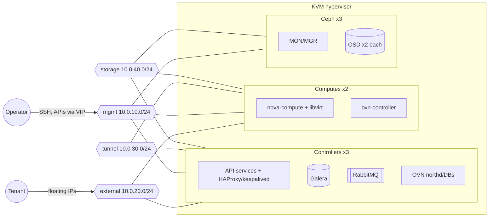
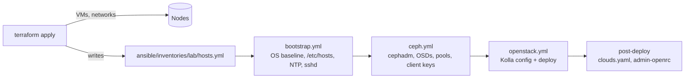

# Architecture

Aura is a multi-node OpenStack cloud with a highly available control plane,
KVM hypervisors and Ceph storage. It also includes a small platform API that
onboards tenants. The reference environment (`lab`) runs every node as a VM on
a single KVM host. It models a production topology closely enough that the same
Ansible roles and Kolla configuration apply to bare metal.

## Topology

## Network plan

Each network is a separate libvirt bridge in the lab. On bare metal, each one
maps to a VLAN on bonded NICs.

| Network    | CIDR           | VLAN (physical) | MTU  | libvirt mode | Carries                                           |
|------------|----------------|-----------------|------|--------------|---------------------------------------------------|
| `mgmt`     | 10.0.10.0/24   | 10              | 1500 | NAT          | SSH, OpenStack internal APIs, Galera, RabbitMQ    |
| `external` | 10.0.20.0/24   | 20              | 1500 | routed       | Neutron provider network (router gateways, FIPs)  |
| `tunnel`   | 10.0.30.0/24   | 30              | 9000 | isolated     | Geneve overlay between OVN chassis                |
| `storage`  | 10.0.40.0/24   | 40              | 9000 | isolated     | Ceph public + cluster traffic, RBD clients         |

Addressing is static and derived from each node's position in its group:

| Group       | Host numbers | Interfaces                          |
|-------------|--------------|-------------------------------------|
| Controllers | .11 - .19    | mgmt, tunnel, storage, external*    |
| Computes    | .21 - .29    | mgmt, tunnel, storage, external*    |
| Ceph        | .31 - .39    | mgmt, storage                       |
| API VIP     | .250 on mgmt | keepalived, moves between controllers |

\* `external` carries no IP. It is attached to OVN's provider bridge.

NICs are renamed by role (`mgmt`, `tunnel`, ...) using cloud-init netplan rules
that match deterministic MAC addresses. Kolla's `globals.yml` can therefore
refer to interfaces by name, with no per-host overrides. See
[ADR 004](adr/004-static-addressing-and-generated-inventory.md).

## Service placement

| Component                          | Runs on                 | Deployed by |
|------------------------------------|-------------------------|-------------|
| Keystone, Glance, Nova API, Neutron server, Placement, Cinder, Horizon | Controllers | Kolla-Ansible |
| MariaDB Galera, RabbitMQ, Memcached, HAProxy + keepalived | Controllers | Kolla-Ansible |
| OVN northbound/southbound DBs, northd | Controllers | Kolla-Ansible |
| cinder-volume (RBD backend)        | Controllers             | Kolla-Ansible |
| nova-compute, libvirt, ovn-controller | Computes             | Kolla-Ansible |
| Prometheus, Alertmanager, Grafana, exporters | Controllers   | Kolla-Ansible |
| Ceph MON, MGR, OSD                 | Ceph nodes              | cephadm |
| Aura platform API                  | Any host with API access | Container image |

Glance images, Cinder volumes and Nova ephemeral disks all live in Ceph pools
(`images`, `volumes`, `vms`). New instances boot as copy-on-write clones of
their image, and live migration needs no shared filesystem.

## Delivery pipeline

1. **Terraform** creates the networks, volumes and VMs, then writes the Ansible
   inventory with every node's addresses.
2. **bootstrap.yml** waits for cloud-init to finish. It then applies the
   baseline to every node: packages, `/etc/hosts`, chrony, sysctl tuning and
   SSH hardening.
3. **ceph.yml** bootstraps Ceph with cephadm on the first storage node and
   enrolls the others. It turns every spare disk into an OSD, then creates the
   RBD pools and the `client.glance` and `client.cinder` keys.
4. **openstack.yml** runs on the first controller, which is the deployment
   host. It installs Kolla-Ansible in a virtualenv, generates an SSH key and
   passwords, and renders `globals.yml` and the inventory. It copies in the
   Ceph config, keys and this repository's alerting rules. Finally it runs
   `bootstrap-servers`, `prechecks`, `deploy` and `post-deploy`.

Every phase is idempotent and can be re-run on its own (see `make help`).

## Security

- **Access.** Password and root SSH logins are disabled. Access uses keys
  injected by cloud-init.
- **Kolla credentials.** Kolla's SSH key and `passwords.yml` are generated on
  the deployment host and never leave it. Nothing secret is committed, and
  `*.tfvars` is gitignored.
- **Ceph keys.** Client keys get the least privilege that works, following the
  upstream "Block Devices and OpenStack" guide. Glance can only write to
  `images`. Cinder and Nova get `volumes` and `vms`, plus read-only access to
  `images`.
- **Platform API.** The API authenticates callers with rotatable API keys,
  compared in constant time. It only acts on projects tagged `aura-managed`,
  and its container runs as an unprivileged user.

## Observability

Kolla deploys Prometheus, Alertmanager, Grafana and the node, MySQL, HAProxy,
RabbitMQ and OpenStack exporters. Prometheus also scrapes the Ceph MGR's
Prometheus module. The alerting rules in
[`monitoring/prometheus/rules`](../monitoring/prometheus/rules) are unit-tested
in CI and copied into Kolla's custom config. Every alert links to a runbook in
[`docs/runbooks`](runbooks/).

The platform API logs JSON with request IDs and exposes
`aura_api_requests_total` and `aura_api_request_duration_seconds` on
`/metrics`.

## Known gaps relative to production

These are deliberate simplifications in the lab:

| Gap | Production approach |
|-----|---------------------|
| All nodes share one hypervisor, so it is a single point of failure. | Spread nodes across physical hosts and racks; use Ceph CRUSH failure domains to match. |
| Internal and external API endpoints use plain HTTP. | Set `kolla_enable_tls_internal`/`kolla_enable_tls_external` and issue certificates from an internal CA. |
| Ceph public and cluster traffic share one network. | Point `ceph_cluster_network` at a dedicated replication network. |
| Terraform state is local. | Use a remote backend with locking. |
| The platform API uses static API keys. | Validate Keystone tokens or front the API with an OIDC proxy. |
